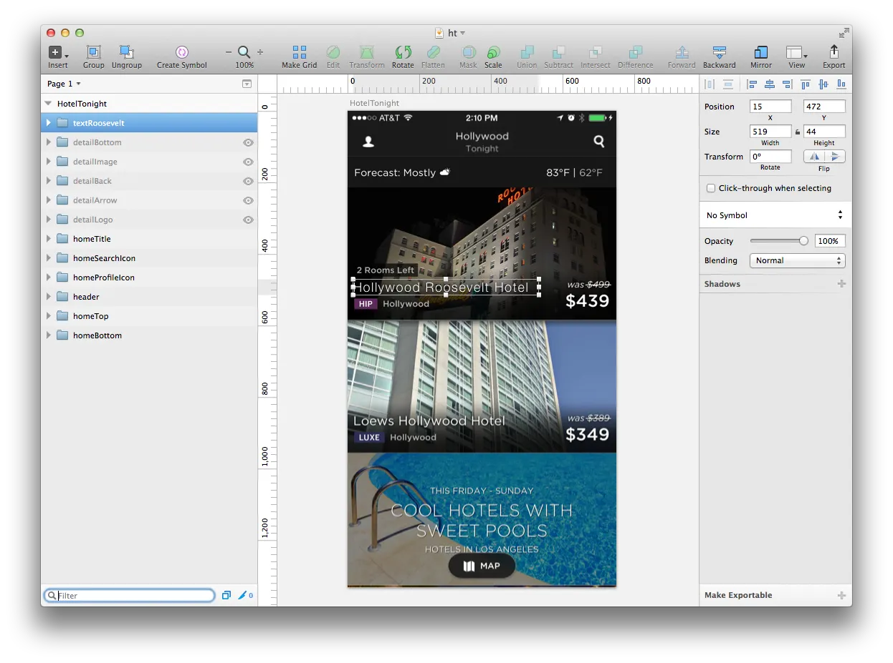
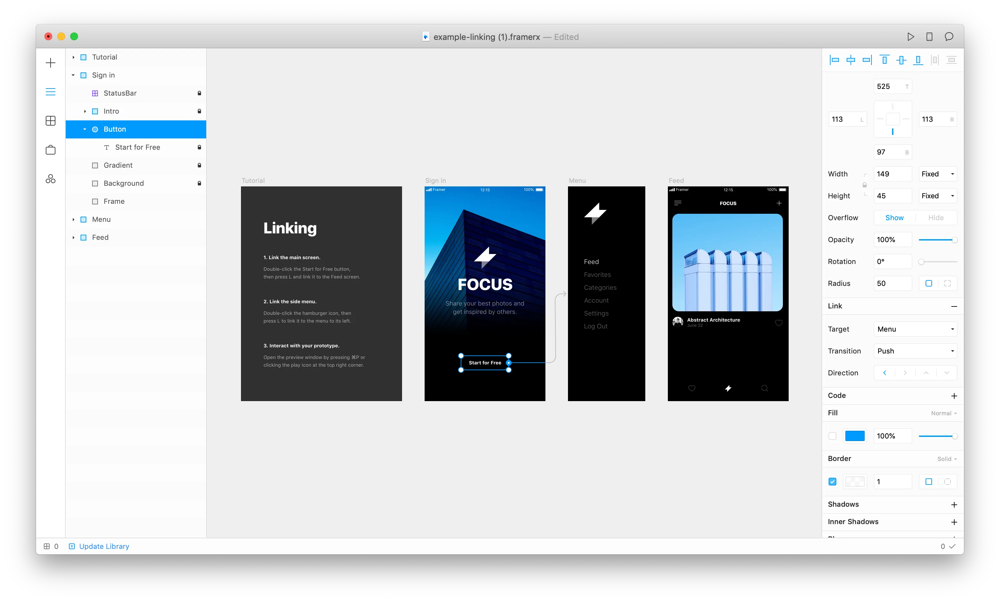

## Un historique

Framer a été fondé en 2014 par Koen Bok et Jorn van Dijk, deux anciens concepteurs de produits chez Facebook et cofondateurs du studio de design Sofa basé à Amsterdam (lancé en 2006 et acquis par Facebook en 2011).
 
Site archivé de Sofa: [madebysofa.com/archive/](http://madebysofa.com/archive/)

